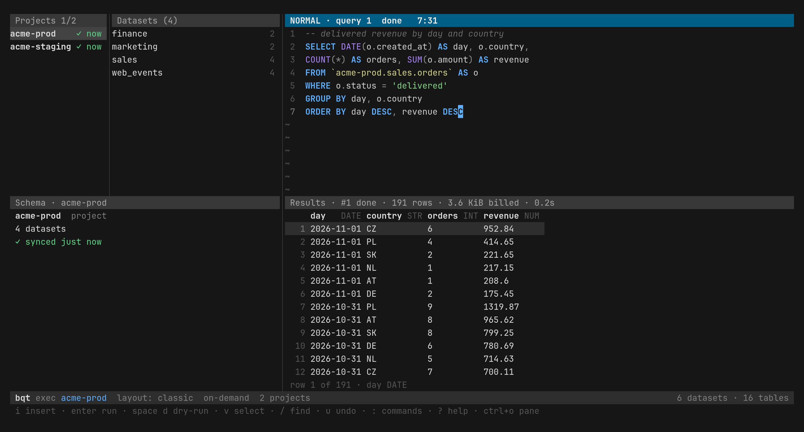

# bqt

A keyboard-driven BigQuery client for the terminal. It searches thousands of datasets instantly, edits SQL with schema-aware completion, caps the cost of every query, and gives AI agents safe, read-only access to BigQuery through a JSON command line and an MCP server.

[Project page](https://davidsevcik.github.io/bigquery-tui/) · [Releases](https://github.com/davidsevcik/bigquery-tui/releases) · [Full guide](docs/usage.md)



## Why

I work with a handful of GCP projects that have over a thousand datasets each, and the BigQuery console was too slow to find anything in them. bqt keeps a local SQLite index of your projects, datasets, tables and columns, so every keystroke searches local data instead of calling the BigQuery API. It lives in the terminal, next to vim, tmux and coding agents.

## What it does

- **Instant search across projects.** One sync fills the local catalog; after that, search and jump-to-table run locally. Filters like `p:prod col:customer_id -d:tmp` narrow by project, dataset, column, label or type.
- **A real SQL editor.** Vim-style editing (or plain, if you prefer), completion of projects, datasets, tables and columns through aliases, CTEs and `UNNEST`, several buffers with crash-safe drafts, and `@name` parameters.
- **No surprise bills.** Every query does a dry-run first. bqt shows the estimate, asks before anything that is not a `SELECT` or scans more than you set, and puts `max_bytes_billed` on the job.
- **Results you can use.** Browse rows in a grid, open one as a record, copy cells or rows as JSON, export everything to CSV, JSON or NDJSON. Tables get a free sample without running a query.
- **History and Favorites.** Every run is kept and searchable. Favorites are plain `.sql` files with typed parameters, so you can keep them in git.
- **Built for agents.** Every command prints JSON when piped, `bqt mcp` serves eight tools over MCP, and both share one policy: read-only, capped and labelled. In the UI, `ctrl+x y` hands a schema, an error or the first rows to the clipboard for an agent.

## Install

With [Homebrew](https://brew.sh) on macOS or Linux:

```sh
brew install davidsevcik/tap/bqt
```

Or with Go 1.26 or newer:

```sh
go install github.com/davidsevcik/bigquery-tui/cmd/bqt@latest
```

Prebuilt binaries for macOS and Linux (amd64 and arm64) are also on the [releases page](https://github.com/davidsevcik/bigquery-tui/releases).

## Quickstart

bqt uses your Application Default Credentials. It needs read access to the data you browse, and permission to run jobs in one project (the Execution project).

```sh
gcloud auth application-default login
bqt                                      # pick your projects with ctrl+x p, then wait for the first sync
```

In the UI, `ctrl+t` jumps to a table, `p` shows a sample of its rows, `ctrl+o` moves to the editor, `ctrl+r` runs the query and `?` lists every key. `ctrl+g` starts a short tutorial.

From the command line or a script:

```sh
bqt sync                                 # refresh the local catalog
bqt search 'orders p:prod -d:tmp'        # find tables
bqt query --dry-run 'SELECT ...'         # what a query would scan, and whether it is allowed
bqt mcp --print-config                   # MCP snippets for Claude Code, Codex and Gemini CLI
```

The [full guide](docs/usage.md) covers every pane, key and command, the agent safety policy, search syntax, exit codes and the config file.

## Agents

Agents can call the commands (Claude Code runs them through Bash) or connect to `bqt mcp`. Either way, only `SELECT` runs (`cli_allow_writes = true` in the config opens the command line, never MCP), each query is capped at `agent_max_bytes` (1 GiB by default) and `agent_timeout` (60 s), and every job is labelled `bqt=1` and kept in History. Flags can only lower the limits. For a hard guarantee, give the Execution project read-only IAM. See [Agents: command line and MCP](docs/usage.md#agents-command-line-and-mcp).

## Docs

- [Full guide](docs/usage.md): keys, commands, safety, search syntax, config.
- [Specification](docs/spec/bqt-v1.md): the v1 design, phases and live checks against BigQuery.
- [Glossary](CONTEXT.md) and [decision records](docs/adr/).

## Contributing and security

Bug reports, ideas and pull requests are welcome. [CONTRIBUTING.md](CONTRIBUTING.md) covers building, testing and releasing. Report security problems privately as described in [SECURITY.md](SECURITY.md).

## License

Apache License 2.0. See [LICENSE](LICENSE) and [NOTICE](NOTICE).

bqt is not made, endorsed or supported by Google. BigQuery is a trademark of Google LLC.
